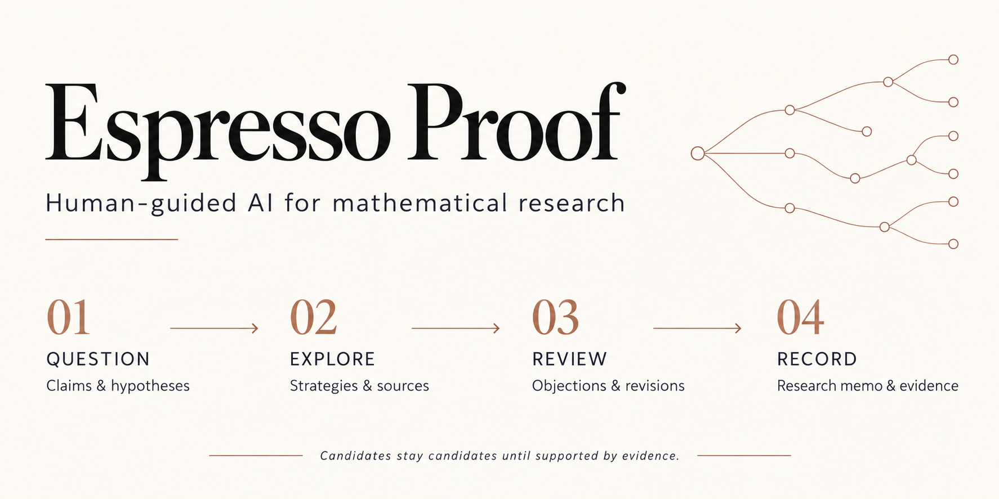

# Espresso Proof



A local workspace for mathematical research with AI agents. Start with a claim
or proof sketch. Explore strategies, examine sources, and revise arguments with
independent reviewer agents. Keep the evidence and open questions in a research memo.

## How it works

- **Explore.** Agents propose strategies, sources, examples, and counterexamples.
- **Review.** Separate agents challenge arguments and identify gaps for revision.
- **Steer.** Inspect the work, prioritize an existing route, and continue or stop.
- **Record.** A deterministic artifact kernel validates records and controls
  evidence labels. Agents cannot certify their own output.

**Alpha research software.** Agent agreement is not a proof certificate. Source
checks and computations support only their recorded scope; Espresso Proof does
not certify mathematical truth.

## Quickstart

Requires [uv](https://docs.astral.sh/uv/), Python 3.11+, and Node.js 20+.
For AI runs, install and authenticate the Codex CLI or Claude Code CLI.

```bash
git clone https://github.com/shaowuz/espresso-proof.git
cd espresso-proof
uv sync --extra dev
npm --prefix web ci
npm --prefix web run build

export ESPRESSO_EXTERNAL_AGENT_COMMAND="uv run espresso-codex-agent"
# For Claude Code: use "uv run espresso-claude-agent" instead.
uv run espresso serve --provider external --host 127.0.0.1 --port 8765
```

Open [localhost:8765](http://127.0.0.1:8765) and enter a claim or proof sketch.
The cockpit starts an initial run and automatically continues an available route;
you can stop it or direct another round. Artifacts are saved under
`projects/<project>/runs/<run_id>/`.

To try the workflow without a model, run `./examples/quickstart.sh` after setup.
This offline demo stops at the strategy-selection gate.

The server has no authentication. Keep it bound to localhost; see
[Security](SECURITY.md).

## Further reading

[Philosophy & trust boundary](docs/product-philosophy.md) ·
[Execution guide](docs/engineering/execution-trunk.md) ·
[Espresso Core integration](docs/engineering/espresso-core-integration.md) ·
[Contributing](CONTRIBUTING.md)

---

Built by [@shaowuz](https://github.com/shaowuz),
[@yangjunjie0320](https://github.com/yangjunjie0320), and
[@w-ruizhe](https://github.com/w-ruizhe).


[MIT License](LICENSE)
