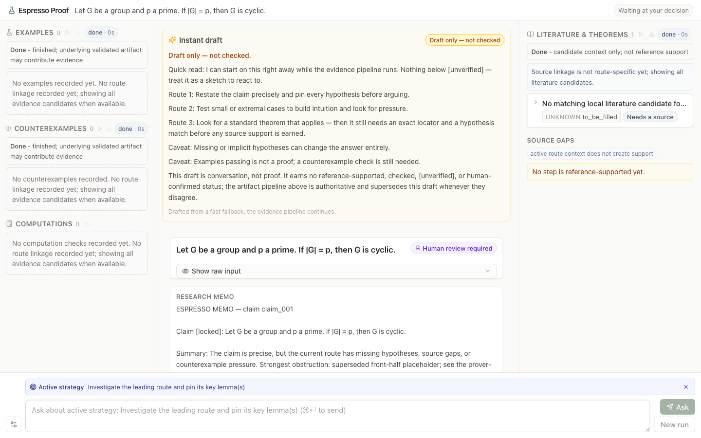

# Espresso Proof

[](LICENSE)
[](pyproject.toml)

**A local, human-guided AI workspace for long-horizon mathematical research.**

Espresso Proof helps a mathematician explore difficult claims without letting
the models that generate an argument certify that argument themselves. Agents
propose routes, sources, examples, counterexamples, proof candidates, and
reviews. A deterministic artifact kernel records the work and controls what
status each result is allowed to carry.

> Generate broadly. Verify narrowly. Spend human attention where it matters.



Espresso Proof is alpha research software. It is **not** a theorem prover or a
formal proof assistant, and it does not certify mathematical truth.

## Why we built it

The project began during an attempt to use a frontier model on a long-horizon
problem in algebraic geometry. The model produced plausible arguments and
revised them repeatedly, but still failed to catch a load-bearing misuse of the
literature. One early example involved a proposed use of a rigidity criterion
in an M23 inverse-Galois investigation.

The important failure was not a lack of mathematical text. It was an imbalance:
the prover could produce more material than either its reviewers or a human
could reliably audit. In context-heavy mathematics, that material can hide
several recurring errors:

- a definition silently changes between steps;
- a cited theorem is real but its hypotheses do not match the problem;
- a result for a generic or very general object is used for every object;
- a candidate source is treated as if it had already been checked;
- a long, confident proof sketch overwhelms the attention available to inspect
  its load-bearing steps.

Espresso Proof was built with @yangjunjie0320 and @w-ruizhe as an attempt to make
these failure modes visible and auditable. It is designed for mathematics that
does not proceed as one linear proof attempt: several vague routes may coexist,
the right intermediate problem may not yet be known, and genuine mathematical
input may be needed between rounds.

## The core idea

The system separates three responsibilities:

1. **Agents generate candidates.** They propose mathematics, sources, attacks,
   and repairs.
2. **The kernel controls status.** It validates schemas, provenance,
   cross-artifact consistency, source locators, hypothesis matches, bounded
   computation records, and allowed state transitions.
3. **The mathematician directs attention.** They can stop a run, inspect its
   artifacts, prioritize an existing route, choose an effort tier, and request
   another bounded round.

The kernel is deliberately limited. It does not understand arbitrary
mathematics well enough to decide whether a theorem is true. It can only grant
a stronger label when the run contains the specific kind of evidence that
label requires. Everything else remains a candidate.

## How the current program works

```text
claim or proof sketch
        |
        v
claim clarification + hypothesis ledger
        |
        v
up to three candidate strategies
        |
        v
bounded prover/reviewer work
        |
        +---- on-demand literature, example, counterexample,
        |     and computation lanes
        v
research memo + local artifact trail
```

The browser cockpit creates a fast initial run and currently auto-continues the
highest-ranked available route to a completed memo. That choice is recorded as
`selected_by=auto` and `human_confirmed=false`. A person can stop the active job
or, before or after completion, direct another round along any existing route.

The headless CLI is more explicit: `espresso orchestrate` stops at the strategy
gate unless `--auto-continue` is supplied.

### Strategy generation and human steering

The Strategy Generator proposes routes but does not score them. A separate,
deterministic grading layer normalizes the proposals, applies conservative
caps and safety rules, keeps at most three, and may replace unsafe or unusable
output with a default investigation route.

Human steering currently works on those existing routes. In the cockpit, a
mathematician can:

- score a route and mark it `focus`, `normal`, `reduce`, or `repair`;
- add a short advisory note for the next round;
- select an allowed effort tier;
- continue a chosen route and append another prover/reviewer round;
- stop an active run.

This feedback changes scheduling and prompt context only. It never upgrades
proof, source, evidence, or refutation status.

Two parts of the broader collaboration vision are **not implemented yet**: the
cockpit cannot insert a completely new human-authored strategy into the kernel
strategy brief, and it does not distribute arbitrary independent budgets across
several routes at once. Today, one continuation selects one existing route and
one allowed effort tier.

### Literature: discovery is not support

Espresso separates finding a source from establishing that it supports a proof
step:

```text
candidate title / author / identifier / statement hint
        |
        v
resolve and read the actual local file or fetched source
        |
        v
extract an exact theorem, proposition, definition, or page locator
        |
        v
match the cited statement and every required hypothesis to one proof step
        |
        v
kernel validation may grant scoped source support
```

A URL and a plausible theorem name are not enough. Literature agents can only
create candidate records. URL retrieval is opt-in, and a source remains
unverified unless the grounding pipeline has the source text, attribution, an
exact locator, the needed statement, and a satisfactory hypothesis and
applicability match. Any support earned applies only to the grounded step, not
automatically to the whole claim.

### Review at several scales

The ordinary prover loop uses independent strategy, evidence, and line-proof
reviewer roles. Their objections become explicit repair targets for later
rounds, but reviewer approval is still advisory.

An optional proof branch goes further:

1. `espresso write-proof` creates a line-numbered proof candidate. Every line
   has a statement, a justification, and typed dependencies.
2. `espresso seal-consensus` runs three different agent reviews over that exact
   proof: line-by-line inference, theorem and lemma applicability, and an
   adversarial gap search.
3. The seal requires unanimous no-fatal-flaw verdicts with cited line IDs and is
   hash-bound to the claim, proof, and grounded sources.

The result is named `agent_consensus_mock_checked`. It is amber and explicitly
unverified: three agents failing to find a flaw is not a proof certificate.
There is no separate paragraph-level checker in the current implementation.

## The trust boundary

Agent wording earns nothing by itself:

| Label or evidence | What can earn it | What it does **not** mean |
|---|---|---|
| `idea_sketch`, `proof_candidate` | An agent proposal | The argument was checked |
| `agent_consensus_mock_checked` | Three adversarial agent reviewers unanimously report no fatal flaw, cite proof lines, and seal the exact artifact hashes | Machine or human verification |
| `source_checked_argument` | Exact source grounding for load-bearing steps, including locators and hypothesis matching | The entire claim is proved |
| `instance_checked`, `computation_checked` | A bounded deterministic verifier ran and recorded a confirming result | Anything beyond the recorded finite or computational scope |
| `lean_checked`, `human_confirmed` | Nothing in the current release; these proof statuses are reserved | A route choice or completed run does not confirm the theorem |

Each run mutation is revalidated. A failed stage rolls back to the last valid
state. Agent-supplied status fields are ignored or rejected, and diagnostic
logs cannot impersonate mathematical evidence.

For the full policy, see [docs/product-philosophy.md](docs/product-philosophy.md).

## Relation to Espresso Core

`espresso-core` is a separate, strategy-guided mathematical prover. It turns a
strategy into typed proof obligations, prover tasks, reviewer tasks, and an
assembled natural-language proof. Espresso Proof can use it experimentally as
a prover backend through `espresso-core-agent`.

The two projects have different roles. Espresso Core concentrates on executing
a proof strategy; Espresso Proof concentrates on long-horizon exploration,
human steering, source grounding, scoped evidence, and honest status tracking.
When Core is used as a backend, its results enter Espresso Proof as candidates;
its internal verifier verdicts do not inherit trusted Espresso Proof status.

## Quickstart

### Requirements

- [uv](https://docs.astral.sh/uv/) and Python 3.11+
- Node.js 20+ and npm for the cockpit
- Optional for real runs: the Codex CLI or Claude Code CLI, or another program
  that implements Espresso's JSON adapter contract

### Install

```bash
git clone https://github.com/shaowuz/espresso-proof.git
cd espresso-proof
uv sync --extra dev
npm --prefix web ci
npm --prefix web run build
```

### Smoke test without a model

The checked-in example uses the deterministic stub provider. It makes no model
or network call, creates a validated run, and stops at the CLI strategy gate:

```bash
./examples/quickstart.sh
```

The script prints the run directory and the command needed to resume it.

### Start the cockpit with a real agent

Configure one of the shipped external adapters:

```bash
export ESPRESSO_EXTERNAL_AGENT_COMMAND="uv run espresso-codex-agent"
# Or: export ESPRESSO_EXTERNAL_AGENT_COMMAND="uv run espresso-claude-agent"

uv run espresso serve \
  --runs-root . \
  --host 127.0.0.1 \
  --port 8765 \
  --provider external
```

Open [http://127.0.0.1:8765](http://127.0.0.1:8765), paste a mathematical claim
or proof sketch, and create a run. Run artifacts are written under
`projects/<project>/runs/<run_id>/` and ignored by Git.

The local server has no authentication. Keep it bound to `127.0.0.1`, do not
put secrets or confidential material into a run, and only configure agent
commands you trust. See [SECURITY.md](SECURITY.md).

### Run headlessly

```bash
printf 'every group of prime order is cyclic\n' > problem.md
uv run espresso orchestrate \
  --input problem.md \
  --project demo \
  --provider stub \
  --auto-continue
```

Headless runs support `stub`, `openai`, and `external` providers. The cockpit
uses `external` so that model execution stays behind the same JSON adapter
boundary.

## What a run contains

Depending on which stages ran, a run directory contains:

- the locked claim and hypothesis ledger;
- candidate sources and source-grounding records;
- examples, counterexamples, and scoped computation results;
- strategy rankings, reviewer objections, and human or automated decisions;
- prover rounds and an optional line-numbered proof candidate;
- `events.jsonl`, `agent_events.jsonl`, and `token_usage.jsonl` traces;
- a compact `final_report.md` and local `research_dashboard.html`.

Artifacts remain advisory unless the kernel can derive a stronger, scoped
status from their recorded evidence.

## Repository map

| Path | Role |
|---|---|
| `espresso_proof/kernel/` | Schemas, validators, status rules, and transactions—the trust boundary |
| `espresso_proof/orchestration/` | Canonical run control flow |
| `espresso_proof/agents/` | Agent clients, prompts, sanitization, and shipped adapters |
| `espresso_proof/literature/` | Candidate discovery, retrieval, extraction, and source grounding |
| `espresso_proof/strategy/` | Route generation, conservative grading, feedback, and scheduling |
| `espresso_proof/verification/` | Bounded deterministic verifiers |
| `espresso_proof/server.py` | Local HTTP server behind the cockpit |
| `web/` | React 19 + TypeScript + Vite cockpit |
| `tests/` | Contract, hard-negative, regression, and UI tests |
| `examples/quickstart.sh` | Deterministic offline smoke test |

`main` is the supported product line.

## Development

Run scoped checks while working:

```bash
uv run espresso export-schemas
uv run espresso export-schemas --check
uv run python -m pytest tests/kernel/test_repository_hygiene.py -q
npm --prefix web test
```

The full merge-gate commands and current CI policy are in
[CONTRIBUTING.md](CONTRIBUTING.md) and
[.github/workflows/full-ci.yml](.github/workflows/full-ci.yml).

Contributions are welcome, especially new deterministic verifiers, source
grounding improvements, and focused changes that preserve the trust boundary.
Start with [CONTRIBUTING.md](CONTRIBUTING.md) and
[docs/engineering/adding-a-deterministic-verifier.md](docs/engineering/adding-a-deterministic-verifier.md).

## Documentation

- [Product philosophy](docs/product-philosophy.md)
- [Execution trunk](docs/engineering/execution-trunk.md)
- [Product-path boundaries](docs/engineering/product-path-boundaries.md)
- [Espresso Core integration](docs/engineering/espresso-core-integration.md)

## Team

Espresso Proof is developed by [@shaowuz](https://github.com/shaowuz),
[@yangjunjie0320](https://github.com/yangjunjie0320), and
[@w-ruizhe](https://github.com/w-ruizhe). The literature subsystem was started
with [@w-ruizhe](https://github.com/w-ruizhe).

## License

MIT — see [LICENSE](LICENSE).
